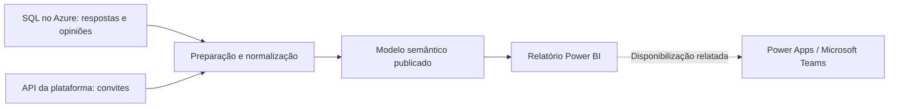

# Customer Experience Analytics — Power BI, Azure SQL e API

Case de análise de experiência do cliente em serviços financeiros: **NPS, CES e CSAT**, integração de respostas e convites e consolidação de ações com diferentes versões.

## Desafio

O banco disponibilizado para análise continha respostas e opiniões, enquanto os convites precisavam ser obtidos pela API da plataforma. Além disso, uma mesma ação aparecia com variações como V1 e V2, dificultando o acompanhamento consolidado. O projeto reuniu essas fontes e padronizou as ações para apoiar uma leitura clara dos indicadores.

## Solução entregue

- Integração com **SQL no Azure e API de convites**, conforme contexto fornecido pelo autor.
- Normalização de ações e agrupamento das versões para análise comparável.
- Visão executiva de NPS, CES, CSAT, distribuição de notas, evolução e comparação entre pesquisas.
- Seleção dinâmica de indicadores e períodos, filtros e detalhamento de comentários.
- **Power Apps para disponibilização dos dados no Microsoft Teams**, conforme relato do autor.

O autor relata duração de atualização inferior a 15 minutos. Esse tempo não foi medido nesta preparação e não indica, por si só, frequência de atualização ou operação em tempo real.

## Arquitetura funcional

O diagrama representa o contexto funcional descrito. O mecanismo técnico entre Power Apps, Power BI e Teams não está nos arquivos recebidos.

## Screenshots
MockUP

## Explore o case

- [Contexto e decisões](docs/contexto.md)
- [Integrações e atualização](docs/integracoes.md)
- [Normalização das ações](docs/normalizacao.md)
- [Modelo e relacionamentos](docs/modelo-relacionamentos.md)
- [Indicadores e interpretação](docs/indicadores.md)
- [Inventário verificado do relatório](docs/inventario.md)
- [Exemplo didático de Power Query](power-query/normalizar-acoes-demo.pq)
- [Verificações e limites](docs/validacao.md)

## Escopo público

Este repositório documenta a solução e inclui um exemplo didático independente. Não distribui o relatório original, dados internos, credenciais, endereços de servidores ou identificadores do ambiente. O material recebido contém um relatório conectado a um modelo publicado; as expressões DAX, consultas reais e definições dos relacionamentos não estão disponíveis nessa exportação.
