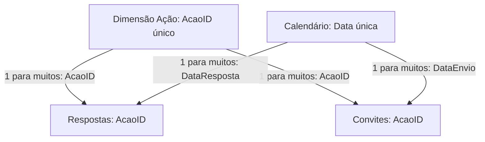

# Modelo e relacionamentos

O relatório referencia tabelas de interações, convites, filtros, calendário, parâmetros e medidas. O arquivo de layout do diagrama contém posições de tabelas, mas não comprova cardinalidade, direção de filtro ou chaves dos relacionamentos.

| Referência observada | Uso observado |
| --- | --- |
| BD_Interações[ACAO] | Análise das interações por ação |
| BD_Interações[answer] | Campo de resposta nos visuais |
| BD_Interações[COMENTARIO] | Detalhamento de comentários |
| BD_Enviados[Data], [name], [status] | Informações de convites/envios |
| BD_Filtros[ACAO_CORRIGIDA] | Seleção por ação normalizada |
| dCalendario[Date] | Contexto temporal |
| pr.Tempo, pr.Eixo_Quantitativos, pr.Eixo_Métricas | Seleções dinâmicas referenciadas |

## Exemplo conceitual para adaptação

**O diagrama é uma proposta didática, não a extração dos relacionamentos originais.** AcaoID, DataResposta e DataEnvio são nomes ilustrativos. No modelo real, é necessário validar chaves, granularidade e papéis das datas.

Evitar junção direta entre fatos de convites e respostas sem avaliar sua granularidade: um convite pode gerar múltiplas respostas a perguntas e uma mesma pessoa pode receber múltiplos convites. Somar linhas pode produzir taxas incorretas.
